**[中文版 README](README.zh-cn.md) · [中英双语封面](assets/readme/hero-bilingual.svg)**

A continuously updated portfolio of AI multi-model supply-chain research: collecting and comparing independent outputs from different models and agents on the same brief, while tracking global supply-chain shifts in real time.

    

## 📊 About

This repository hosts a portfolio website that places six AI-generated supply-chain research reports side by side — each produced by a different model or agent working independently on the **same research brief**. The goal is to see how different AI minds approach the same question: what they emphasize, what they miss, and where they agree.

Alongside the reports, the site includes a **weekly supply-chain radar** (cross-verified news, research, and trends) and **five spin-off applications** — [VeloCortex Maritime](#velocortex-maritime), [TariffLens](#tarifflens), [Integrated Planning Workbench](#integrated-planning-workbench), [Inventory Control Desk](#inventory-control-desk) and [FLOWLENS](#flowlens) — that turn the research findings into runnable product prototypes, from S&OP planning through inventory execution to order-to-delivery attribution.

## ✨ Features

- 📡 **Live Radar** — Weekly, cross-verified intelligence on shipping rates, tariffs, and supply-chain events — every item links to its original source.
- 🔀 **Multi-Model Comparison** — Same brief, six independent AI tools. A horizontal comparison matrix highlights each model's lens, data sources, and signature trait.
- 🔓 **Fully Open** — Every report, the radar and all five spin-off apps are inspectable: source repos on GitHub, every claim traces to a primary source — no fabrication, no silent data swaps.

## 🔬 The Research Portfolio

Six reports, six AI minds, one brief. Each report is a self-contained, renderable HTML dashboard you can open in a new tab.

| Report | Model · Toolchain | Role | Signature Trait |
| --- | --- | --- | --- |
| **Cursor × Grok** | Grok 4.5 High Fast · Cursor Agent + Canvas | The Archivist-Editor | Journal-style decision support — same 5 questions every edition, directly comparable across issues. |
| **Kimi Agent** | Kimi K3 Deep Research · Kimi Agent | The Feature Writer | Live market quotes + 24 tier-classified citations; explicitly labels fallback snapshots when feeds are down. |
| **WorkBuddy** | Deepseek-V4-Pro · WorkBuddy Agent | The Research Controller | Sticky 3-axis control bar (lens / window / language); every KPI and chart updates instantly. |
| **Gemini** | Gemini 3.8 Flash · Search Grounding | The Strategic Intelligence Officer | Full-stack workbench with AI Q&A that re-grounds to the selected reporting window; keys stay server-side. |
| **Codex** | GPT-6 Astra · OpenAI Codex | The Time-Window Guardian | States its temporal rules up front: flows aggregate but stocks don't, half-year ratios are not quarter averages, missing values are left blank rather than zero. |
| **Claude Code** | Opus 5.5 · Claude Code | The Manifest Proofreader | The only report with a dedicated state for "not yet published": gaps read "Pending" rather than being estimated, and quarterly values derived from cumulative totals are marked "derived". |

## 🚢 Spin-off Apps

### VeloCortex Maritime

Where the research ends, the product begins. **VeloCortex Maritime** is a global container-tracking command center built from the pain points that surfaced across all six reports — visibility gaps, demurrage-risk blind spots, and cold-chain failures.

Features: live AIS vessel tracking, port-congestion heatmaps, demurrage-risk prediction, cold-chain telemetry, and SheetJS export. Built with React 19 + Express, powered by Gemini AI inference on IoT telemetry.

### TariffLens

_Tariff & Trade-Compliance Reference._ A browser-based reference desk for US import tariffs, born from the same findings: how to look up a rate, how to flag ADD/CVD, and why a textual cross-reference never yields a number. It enforces three hard red lines — no automatic classification, never output a number for a textual cross-reference, and a strict three-tier data separation (snapshot rates / live bulletins / offline demo), with every tier boundary labelled.

Features: L1 snapshot (USITC HTS 2026 rev.9 + Chapter 99), L2 live Federal Register pull with local-snapshot fallback, a data-age indicator that flags stale snapshots (14+ days) in vermilion, and a collapsed reference estimate that refuses to convert specific/compound rates. Pure static site — no build, no server.

### Integrated Planning Workbench

_S&OP, forecasting and category action planning._ A browser-native decision prototype for demand planners and category managers: a forecasting arena, a PSI decision desk and a category action board all share one business scope and one public retail sample (Mendeley, CC BY 4.0). Seven forecasting models compete on a fixed 56/28-day split with no tuning; PSI scenarios compare 90/95/98% safety-stock assumptions; the category board ranks by ABC–XYZ and records human decisions. Exports are marked `DEMO_ACTION_NOT_ORDER` — a review list, not a purchase order.

Features: JSON + ES modules over HTTP (no build, no account, no API key), source-file SHA-256 verification, per-day P/S/I drill-down, a synthetic teaching case with deliberately negative results, and explicit "not provided" labels where the public sample lacks stock, PO/ETA or promotions. Hosted in this repository at `docs/reports/integrated-planning-workbench/`.

### Inventory Control Desk

_Inventory control execution._ The execution-layer counterpart to the planning workbench: purchase orders, in-transit, on-hand, alerts, replenishment, batch aging and E&O all read from one inventory snapshot and one metric engine. Built from UCI Online Retail (id=352, CC BY 4.0) — 541,909 real transactions replayed into a 120-SKU / 52-week ledger. Real and derived fields are registered separately, and every suggested quantity is labelled a demo derivation, not a purchase order.

Features: 12 views; SS / ROP with both demand and lead-time variance, empirical LTD quantiles for intermittent demand; an ABC×XYZ service-level matrix; supplier OTD rolling updates to L and σ_L; FIFO batch aging; E&O gross / provision / net; source, dataset and rule SHA-256 fingerprints recomputed in the browser; 14 limits and 4 red lines always visible. Standalone repo [SummerPapaya/inventory-control-desk](https://github.com/SummerPapaya/inventory-control-desk), live at `summercommences.com/inventory-control-desk/`, MIT + NOTICE.

### FLOWLENS

_Order-to-delivery analytics._ A reusable analysis desk over 99,441 real Olist orders: nine relational tables joined into one order-level fact table, splitting the promise-to-delivery cycle into four stages and separating on-time rate into promise buffer versus actual fulfilment. All metrics are re-aggregated in the browser — no external requests, no LLM, no claim of real-time data.

Features: Wilson 95% lower-bound anomaly screening with a minimum sample size, promise-window what-if scenarios, delay Pareto attribution, 409 seller-state → customer-state lanes, 43 checkable investigation tasks (significant lanes, data-quality gaps and SCOR playbooks) with CSV / print export, and 15 limits expanded by default. The headline 93.22% on-time rate is mostly a loose 24-day promise buffer rather than operational excellence: tightening the promise to 7 days drops it to 31.81%. Hosted in this repository at `docs/reports/flowlens/`.

## 🚀 Quick Start

Clone the portfolio site and serve it locally — no build step required:

```bash
# Clone this repository
git clone https://github.com/SummerPapaya/supply-chain-portfolio.git
cd supply-chain-portfolio

# Serve the static site (the site lives under docs/)
python3 -m http.server 8000 --directory docs

# Open in your browser
# → http://localhost:8000
```

Each report's dashboard lives under `docs/reports/<name>/` and opens in a new tab from the portfolio homepage. The five self-contained single-file reports (cursorgrok / kimiagent / workbuddy / codex / claudecode) work fully offline; the React-built Gemini report, the VeloCortex spin-off, **Integrated Planning Workbench** and **FLOWLENS** need a local server (JSON / fact-table loads). **TariffLens** and **Inventory Control Desk** are separate fully static sites deployed at `summercommences.com/tarifflens/` and `summercommences.com/inventory-control-desk/`; the homepage links out to both instead of keeping a second copy in this repository.

## 📁 Project Structure

```
docs/                        # GitHub Pages site root
├── index.html               # Portfolio homepage (hero, radar, comparison, cards)
├── radar-data.json          # Weekly radar data (embedded snapshot + override source)
├── reports/
│   ├── cursorgrok/          # Cursor × Grok — static HTML dashboard
│   ├── kimiagent/           # Kimi Agent — single-file HTML + D3.js
│   ├── workbuddy/           # WorkBuddy — single-page HTML + Chart.js
│   ├── codex/               # Codex — offline bilingual HTML + hand-rolled SVG
│   ├── claudecode/          # Claude Code — single-file bilingual HTML, Pending/derived data discipline
│   ├── gemini/              # Gemini — React 19 build (static)
│   ├── velocortex/          # VeloCortex Maritime — React 19 build (static)
│   ├── integrated-planning-workbench/  # IPW — forecast / PSI / category actions
│   └── flowlens/            # FLOWLENS — Olist fact table, in-browser aggregation
│                             # (TariffLens → SummerPapaya/tarifflens; Inventory Control Desk →
│                             #  SummerPapaya/inventory-control-desk. Both linked out, no local copy.)
├── learning/                # Embedded CSCP & Six Sigma knowledge graphs
├── assets/                  # Hero SVGs, card curtain previews
└── README-preview.html      # Standalone HTML preview of this README

scripts/                     # Radar data refresh + Feishu auto-AI entry
assets/                      # README hero SVGs (used at repo root)
README.md / README.zh-cn.md  # Bilingual portfolio documentation
```

## 🛠 Tech Stack

- **Portfolio site** — Vanilla HTML/CSS/JS, zero dependencies, zero build step
- **Cursor × Grok / Kimi / WorkBuddy / Codex / Claude Code reports** — Self-contained single-file HTML
- **Gemini / VeloCortex apps** — React 19 + Vite, built to static assets
- **TariffLens app** — Vanilla HTML/CSS/JS, zero dependencies, zero build (separate repo: SummerPapaya/tarifflens)
- **Integrated Planning Workbench / FLOWLENS apps** — Vanilla HTML/CSS/JS, in-browser aggregation, zero build (under `docs/reports/`)
- **Inventory Control Desk app** — Vanilla HTML/CSS/JS + single metric engine, 12 views (separate repo: SummerPapaya/inventory-control-desk, MIT + NOTICE)
- **Data sources** — GSCPI, Drewry WCI, SCFI, WTO, NY Fed, UNCTAD, China Customs, IATA, MIIT, NBS, SEMI, ACEA, and more (25+ institutions)

## 📄 License

**© 2026 SummerPapaya (Summer Li)** — [github.com/SummerPapaya](https://github.com/SummerPapaya).

Original portfolio content (site design, code, radar compilation, analysis and visualisations) is licensed under
[CC BY-NC-ND 4.0](https://creativecommons.org/licenses/by-nc-nd/4.0/): attribution required, no commercial use,
no derivatives. See [`LICENSE`](LICENSE). Third-party material and individual report pages keep their own licences —
see [`NOTICE`](NOTICE); those local licences take precedence for the material they cover. Radar items come from
public reporting; refer to the original citation attached to each item.

---

<p align="center">
  <em>Built as a living experiment: one brief, six AI minds, one open portfolio.</em><br>
  <a href="https://github.com/SummerPapaya">github.com/SummerPapaya</a> · © 2026 SummerPapaya (Summer Li) · CC BY-NC-ND 4.0
</p>
