**[English README](README.md) · [Bilingual Cover](assets/readme/hero-bilingual.svg)**

一个持续更新的 AI 多模型供应链研究作品集：在相同的调研命题下，收集并对比不同模型与智能体各自独立产出的结果，同时实时追踪全球供应链的动态变化。

    

## 📊 项目简介

这个仓库托管了一个作品集网站，将六份由 AI 生成的供应链研究报告并排展示——每份报告都由不同的模型或智能体，在**同一个调研命题**下独立产出。我们的目标，是观察不同的 AI "思维"如何回答同一个问题：它们各自强调什么、忽略了什么、又在何处达成共识。

除了报告本身，网站还包含一个**每周供应链雷达**（交叉验证的新闻、研究与趋势），以及**五个衍生应用**——[VeloCortex Maritime](#velocortex-maritime)、[TariffLens](#tarifflens)、[计划与品类决策工作台](#计划与品类决策工作台integrated-planning-workbench)、[库存控制台](#库存控制台inventory-control-desk) 与 [履约与承诺归因台](#履约与承诺归因台flowlens)——把研究发现转化为可运行的产品原型，覆盖从 S&OP 计划、库存执行到履约归因的完整链路。

## ✨ 核心特性

- 📡 **实时雷达** — 每周更新、经过交叉验证的情报：覆盖运价、关税与供应链事件——每条信息都链接到原始来源。
- 🔀 **多模型对比** — 同一命题，六款独立 AI 工具。横向对比矩阵清晰呈现每个模型的视角、数据来源与标志性特征。
- 🔓 **完全开放** — 报告、雷达与五个衍生应用均可查阅：源码仓库托管于 GitHub，每一个论断都可追溯到一手来源——不虚构、不暗箱替换数据。

## 🔬 研究报告作品集

六份报告，六种 AI 思维，一个命题。每份报告都是一个自包含、可渲染的 HTML 仪表盘，可在新标签页中打开。

| 报告 | 模型 · 工具链 | 角色定位 | 标志性特征 |
| --- | --- | --- | --- |
| **Cursor × Grok** | Grok 4.5 High Fast · Cursor Agent + Canvas | 档案主编 | 杂志式的决策支持——每期固定 5 个问题，各期之间可直接横向比较。 |
| **Kimi Agent** | Kimi K3 Deep Research · Kimi Agent | 深度特稿主笔 | 实时行情报价 + 24 条分级引用；数据源中断时，明确标注兜底快照。 |
| **WorkBuddy** | Deepseek-V4-Pro · WorkBuddy Agent | 研究中控师 | 粘性的三轴控制条（视角 / 窗口 / 语言）；每个 KPI 与图表即时更新。 |
| **Gemini** | Gemini 3.8 Flash · Search Grounding | 战略情报官 | 全栈工作台，内置 AI 问答可重新锚定到所选报告窗口；密钥始终留在服务端。 |
| **Codex** | GPT-6 Astra · OpenAI Codex | 口径守门人 | 唯一把「时间窗口语义」写进正文的报告：流量可加总而存量不可、半年比率不等于两季平均，缺数一律留空而非补零。 |
| **Claude Code** | Opus 5.5 · Claude Code | 舱单校勘员 | 唯一为「尚未发布」专设状态的报告：缺口一律写「待发布」而非估算填补，由累计值相减得到的季度数标注「推算」。 |

## 🚢 衍生应用

### VeloCortex Maritime

研究结束之处，产品由此而生。**VeloCortex Maritime** 是一个全球集装箱追踪指挥中心，它诞生于六份报告中共同浮现的痛点——可视化盲区、滞期费风险盲区，以及冷链失温。

功能包括：实时 AIS 船舶追踪、港口拥堵热力图、滞期费风险预测、冷链遥测，以及 SheetJS 导出。基于 React 19 + Express 构建，由 Gemini AI 对 IoT 遥测数据进行推理驱动。

### TariffLens

_关税与贸易合规参考台。_ 一个浏览器端的美国进口关税参考台，同样源于这些研究发现：怎么查税率、怎么标记 ADD/CVD、为什么文本交叉引用绝不出数字。它坚守三条硬红线——不做自动归类、文本引用形态绝不输出数字、三层数据分治（快照税率 / 实时公告 / 离线演示），每一层边界都显式标注。

功能包括：L1 快照（USITC HTS 2026 rev.9 + Chapter 99）、L2 浏览器直连 Federal Register（失败回退本地快照）、数据龄提示（超过 14 天标朱红 stale）、以及默认折叠、拒绝折算从量 / 复合税率的参考测算。纯静态站点——无需构建、无需服务端。

### 计划与品类决策工作台（Integrated Planning Workbench）

_预测擂台 → PSI 决策台 → 品类行动台。_ 面向需求计划员与品类经理的可运行决策原型：三层视图共用同一业务范围与同一份公开零售样本（Mendeley，CC BY 4.0）。七种预测模型在固定的 56 / 28 天切分上并列比拼、不调参；PSI 情景比较 90 / 95 / 98% 安全量假设；品类行动台按 ABC–XYZ 排序并记录人工纳入、暂缓与不采纳的原因。导出标记 `DEMO_ACTION_NOT_ORDER`——是待复核清单，不是采购单。

功能包括：JSON + ES modules 经 HTTP 加载（无需构建、账户或 API key）、源文件 SHA-256 核对、逐日 P / S / I 明细下钻、用虚构记录演示负结果的合成教学案例，以及公开样本缺少可售库存、PO / ETA 与促销执行时直接标注「未提供」。位于本仓库 `docs/reports/integrated-planning-workbench/`；直接双击 HTML 无法运行，须经本地服务。

### 库存控制台（Inventory Control Desk）

_库存控制执行层。_ 与上游计划工作台互补：采购订单、在途、On-hand、预警、补货、批次库龄与 E&O 全部读同一份库存快照、同一个指标引擎。基于 UCI Online Retail（id=352，CC BY 4.0）541,909 行真实交易，回放生成 120 SKU × 52 周台账；真实字段与推导字段逐项登记，建议补货量一律标注为演示推导，不是采购单。

功能包括：12 个视图；SS / ROP 同时计入需求与交期波动，间歇需求改用 LTD 经验分位数；ABC×XYZ 九宫格定服务水平；供应商实测 OTD 滚动更新 L 与 σ_L；FIFO 批次库龄；E&O 毛额 / 计提 / 净额三口径；源文件 / 数据集 / 规则三类 SHA-256 指纹在浏览器当场复算；14 条局限与 4 条红线默认可见。独立仓库 [SummerPapaya/inventory-control-desk](https://github.com/SummerPapaya/inventory-control-desk)，线上地址 `summercommences.com/inventory-control-desk/`，采用 MIT + NOTICE。

### 履约与承诺归因台（FLOWLENS）

_基于真实订单数据的履约分析台。_ 用 Olist 公开数据集 99,441 笔真实订单，把 9 张关系表按公开 join 规则落成一张订单级事实表，拆解下单 → 审批 → 交承运 → 送达四段周期，把「按时率」拆成承诺缓冲与实际履约两件事。全部指标在浏览器内重新聚合——零外部请求、无 LLM、不冒充实时。

功能包括：Wilson 95% 下界 + 最小样本量的异常筛查、承诺窗口 what-if 情景、延迟订单帕累托归因、409 条「卖家州 → 客户州」线路、43 条可勾选核查任务（显著线路 / 数据质量缺口 / SCOR 标准剧本）与 CSV 或打印导出、15 条局限默认展开。结论照实：93.22% 的按时率主要来自中位 24 天的宽松承诺缓冲，而非履约能力；承诺收紧到 7 天时按时率只剩 31.81%。位于本仓库 `docs/reports/flowlens/`。

## 🚀 快速开始

克隆作品集网站并在本地启动——无需构建步骤：

```bash
# 克隆本仓库
git clone https://github.com/SummerPapaya/supply-chain-portfolio.git
cd supply-chain-portfolio

# 启动静态站点（站点位于 docs/ 目录）
python3 -m http.server 8000 --directory docs

# 在浏览器中打开
# → http://localhost:8000
```

每份报告的仪表盘位于 `docs/reports/<名称>/` 目录下，可从作品集首页在新标签页中打开。五份自包含单文件报告（cursorgrok / kimiagent / workbuddy / codex / claudecode）完全离线可用；Gemini 报告、VeloCortex 衍生应用、**计划与品类决策工作台** 与 **FLOWLENS** 需要通过本地服务访问（JSON / 事实表加载）。**TariffLens** 与 **库存控制台** 是独立、完全静态的站点，分别部署于 `summercommences.com/tarifflens/` 与 `summercommences.com/inventory-control-desk/`；首页直接外链，不在本仓库保留第二份副本。

## 📁 项目结构

```
docs/                        # GitHub Pages 站点根目录
├── index.html               # 作品集首页（封面、雷达、对比、卡片）
├── radar-data.json          # 每周雷达数据（内嵌快照 + 可覆盖源）
├── reports/
│   ├── cursorgrok/          # Cursor × Grok — 静态 HTML 仪表盘
│   ├── kimiagent/           # Kimi Agent — 单文件 HTML + D3.js
│   ├── workbuddy/           # WorkBuddy — 单页 HTML + Chart.js
│   ├── codex/               # Codex — 离线双语 HTML + 原生 SVG 图表
│   ├── claudecode/          # Claude Code — 单文件双语 HTML，待发布 / 推算数据纪律
│   ├── gemini/              # Gemini — React 19 构建（静态）
│   ├── velocortex/          # VeloCortex Maritime — React 19 构建（静态）
│   ├── integrated-planning-workbench/  # 计划与品类决策工作台 — 预测 / PSI / 品类行动
│   └── flowlens/            # FLOWLENS — Olist 订单事实表，浏览器内聚合
│                             # （TariffLens → SummerPapaya/tarifflens；库存控制台 →
│                             #  SummerPapaya/inventory-control-desk。二者仅外链，不保留本地副本。）
├── learning/                # 内嵌的 CSCP 与 Six Sigma 知识图谱
├── assets/                  # 封面 SVG、卡片幕布预览
└── README-preview.html      # 本 README 的独立 HTML 预览

scripts/                     # 雷达数据刷新 + 飞书自动入库
assets/                      # README 封面 SVG（用于仓库根目录）
README.md / README.zh-cn.md  # 中英双语作品集说明
```

## 🛠 技术栈

- **作品集网站** — 原生 HTML/CSS/JS，零依赖，零构建步骤
- **Cursor × Grok / Kimi / WorkBuddy / Codex / Claude Code 报告** — 自包含单文件 HTML
- **Gemini / VeloCortex 应用** — React 19 + Vite，构建为静态资源
- **TariffLens 应用** — 原生 HTML/CSS/JS，零依赖、零构建（独立仓库：SummerPapaya/tarifflens）
- **计划与品类决策工作台 / FLOWLENS 应用** — 原生 HTML/CSS/JS，浏览器内聚合，零构建（位于 `docs/reports/`）
- **库存控制台应用** — 原生 HTML/CSS/JS + 单一指标引擎，12 个视图（独立仓库：SummerPapaya/inventory-control-desk，MIT + NOTICE）
- **数据来源** — GSCPI、Drewry WCI、SCFI、WTO、纽约联储、UNCTAD、中国海关、IATA、工信部、国家统计局、SEMI、ACEA 等（25+ 机构）

## 📄 许可证

**© 2026 SummerPapaya（Summer Li）** — [github.com/SummerPapaya](https://github.com/SummerPapaya)。

本站原创内容（页面设计、代码、雷达汇编、分析文案与可视化）采用
[CC BY-NC-ND 4.0](https://creativecommons.org/licenses/by-nc-nd/4.0/deed.zh-hans) 许可：须署名、禁止商用、禁止改编。
详见 [`LICENSE`](LICENSE)。第三方素材与各报告页自带的许可不受本许可覆盖，见 [`NOTICE`](NOTICE)，
其原有许可对相应素材优先适用。雷达信息源自公开报道，每个数据点的原始引用请参见对应出处。

---

<p align="center">
  <em>作为一个持续演进的实验而构建：一个命题，六种 AI 思维，一个开放的仓库。</em><br>
  <a href="https://github.com/SummerPapaya">github.com/SummerPapaya</a> · © 2026 SummerPapaya（Summer Li）· CC BY-NC-ND 4.0
</p>
