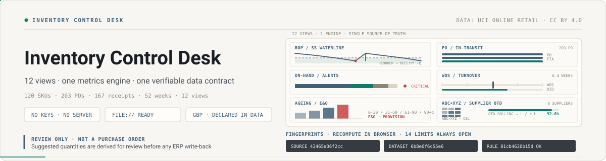

# Inventory Control Desk · 库存控制工作台

[中文版本](README.md)

Purchase orders, in-transit, on-hand, alerts, replenishment, ageing and E&O on one inventory snapshot: 12 views reading from a single metrics engine. Plain static HTML / CSS / JS — no dependencies, no keys, no server.

> The ledger is a **demo replay built from public real demand**, not any company's ERP / WMS records. Suggested order quantities are derived for demonstration and are **not a purchase order**; human review is required before any ERP write-back.

## Quick start

```bash
# Option 1: open index.html directly (file:// works)
# Option 2: local static server
python3 -m http.server 8765
# then open http://127.0.0.1:8765/
```

No build step and no install. Use **Import data** (top right) for your own CSV / JSON, **Template** for the standard intake template, and **Export CSV** for the filtered result of the current view.

## 12 views

| Layer | Views | Question answered |
|---|---|---|
| Monitor | Overview, Alert centre | Which SKUs need attention today, ranked by severity |
| Execution | Inventory ledger, Purchase orders, In-transit | What is on hand, what is ordered, when it arrives |
| Analysis | Ageing, Excess & E&O, Performance, ABC×XYZ service levels, Supplier lead time & OTD | Where capital is stuck, what to stop, what service target to set, whether suppliers deliver |
| Setup | Parameters & definitions, Evidence & known limits | How formulas work, which conclusions cannot be trusted |

## Data and definitions

- **Observed data**: UCI Machine Learning Repository *Online Retail* (id=352) — 541,909 transactions → 527,906 valid rows → 120 SKUs × 52 weeks of real demand. The official variable table declares `UnitPrice` in sterling (GBP).
- **Derived data**: the inventory ledger, 203 POs, 179 batches and 167 delivery receipts are generated by a continuous-review `(s,Q)` replay of observed weekly demand. Observed and derived fields are registered separately under **Parameters & definitions**.
- **Two money bases**: `unit_price` / weekly revenue are **sales value**; all inventory, in-transit, PO, E&O and turnover amounts are **cost value** (quantity × estimated unit cost). They must not be added together.
- **Currency**: declared by `dataset.meta.currency` (ISO 4217). For your own data, set JSON `meta.currency` or a CSV comment line `# currency=CNY`. Switching currency changes symbols and export metadata only — **no FX conversion, no effect on any metric**.

## Key formulas

```
SS  = z · √( L·σ_d² + d̄²·σ_L² )        # intermittent Z items use an empirical LTD quantile
ROP = d̄·L + SS
IP  = available + open PO                # inventory position includes in-transit
```

An ABC×XYZ 3×3 matrix sets differentiated CSL (→ SS / ROP). Supplier OTD receipts rolling-update `L` and `σ_L` across contract / rolling / blend modes. Every metric comes from `assets/engine.js` as the single source of truth; the UI never computes business metrics itself.

## Evidence and known limits

The **Evidence & known limits** view shows 14 limits, expanded by default with no collapse control, each pairing a quantified fact with a concrete next step. Three fingerprints can be recomputed and compared inside the browser:

| Fingerprint | What it covers |
|---|---|
| Source file | SHA-256 of the original UCI Excel |
| Canonical dataset | SHA-256 of the normalised JSON, excluding `meta.evidence` itself |
| Rules | SHA-256 and version of `assets/engine.js` |

The exported `ICW_evidence_handoff.csv` is an **evidence handoff**, not a purchase order.

## Reproduce and verify

```bash
python3 scripts/build_data.py      # rebuild dataset.json / dataset.js from the UCI Excel
python3 scripts/build_banner.py    # regenerate both animated README banners
node scripts/verify_engine.js      # metrics engine assertions
node scripts/verify_otd.js         # lead time / OTD assertions
```

- The raw dataset (about 23 MB of `Online Retail.xlsx`) is **not distributed in this repository**; download it from UCI and place it under `data/`. The built snapshots `assets/dataset.json` and `assets/dataset.js` are included, so the app runs as-is.
- `scripts/verify_*.mjs` are real-browser interaction suites. Prerequisites: a local static server on `127.0.0.1:8765` and Chrome with remote debugging on port `9333`. They are local regression tests and never contact external services.

## Data source and licence

Data: [UCI ML Repository · Online Retail (id=352)](https://archive.ics.uci.edu/dataset/352/online+retail),
Chen, D. (2015), *Online Retail*, DOI [10.24432/C5BW33](https://doi.org/10.24432/C5BW33), licensed **CC BY 4.0** (attribution required).
This repository publishes only aggregated snapshots and code derived from that dataset — no raw transaction rows and no customer personal data.

## Licence

- Code, original documentation and banners: **MIT** — see [LICENSE](LICENSE).
- Data snapshots `assets/dataset.json` / `dataset.js`: derived from UCI Online Retail and still under **CC BY 4.0** — attribution, adaptation notes and boundaries of use are in [NOTICE.md](NOTICE.md).

> The data snapshot is not relicensed by this repository's MIT terms; keep sections 1 and 2 of NOTICE when copying or redistributing it.
> "Suggested quantities are not a purchase order" is a factual disclosure (NOTICE §4), not an additional licence restriction on use.
