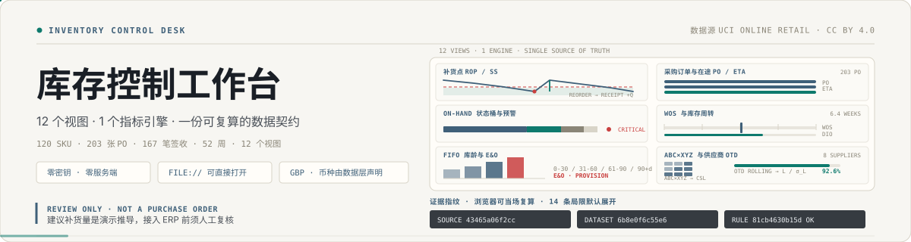

# 库存控制工作台 · Inventory Control Workbench

[English version](README.en.md)

把**采购订单 → 在途 → On-hand → 预警 → 补货决策 → 库龄 / E&O** 放进同一份库存快照，12 个视图共用一个指标引擎。纯静态 HTML / CSS / JS，零依赖、零密钥、零服务端。

> 这是基于**公开真实需求回放生成的演示台账**，不是任何企业的 ERP / WMS 记录。界面里给出的建议补货量是演示推导，**不是采购单**，接入 ERP 前必须人工复核。

## 快速开始

```bash
# 方式一：直接双击 index.html（file:// 可用）
# 方式二：本地静态服务
python3 -m http.server 8765
# 打开 http://127.0.0.1:8765/
```

无需构建、无需安装依赖。右上角「导入数据」可载入自有 CSV / JSON；「模板」可下载标准导入模板；「导出 CSV」导出当前视图的筛选结果。

## 12 个视图

| 层 | 视图 | 回答什么 |
|---|---|---|
| 监控 | 总览、预警中心 | 今天哪些 SKU 出问题、按严重度排序 |
| 执行 | 库存台账、采购订单、在途追踪 | 现在有多少、订了什么、什么时候到 |
| 分析 | 库龄分析、冗余与 E&O、绩效分析、分类与服务水平、供应商交期与 OTD | 钱压在哪里、该不该停、服务水平定几档、供应商是否靠谱 |
| 配置 | 参数与口径、证据与局限 | 公式怎么算、哪些结论不能当真 |

## 数据与口径

- **真实数据**：UCI Machine Learning Repository「Online Retail」(id=352)，541,909 行交易 → 527,906 行有效 → 120 SKU × 52 周真实需求序列。`UnitPrice` 官方单位声明为 sterling（GBP）。
- **推导数据**：库存台账、203 张 PO、179 个批次、167 笔交付签收，均由连续检查 `(s,Q)` 策略回放真实周需求生成。真实字段与推导字段在「参数与口径 → 字段口径」逐项登记。
- **两种金额口径**：`unit_price` / 周销售额是**售价口径**；所有库存、在途、PO、E&O、周转金额是**成本口径**（数量 × 估算单位成本）。两者不可相加。
- **币种**：由 `dataset.meta.currency`（ISO 4217）声明；导入自有数据时用 JSON 的 `meta.currency` 或 CSV 注释行 `# currency=CNY` 指定。切换币种只改符号与导出元信息，**不做汇率换算、不参与计算**。

## 关键公式

```
SS  = z · √( L·σ_d² + d̄²·σ_L² )        # Z 类间歇需求改用 LTD 经验分位数
ROP = d̄·L + SS
IP  = available + open PO                # 库存位置含在途
```

ABC×XYZ 九宫格决定差异化 CSL（→ SS / ROP）；供应商实测 OTD 滚动更新 `L` 与 `σ_L`，支持契约 / 实测 / 混合三模式。所有指标由 `assets/engine.js` 单一计算源产出，UI 不自行计算业务指标。

## 证据与局限

「证据与局限」视图默认展示且**不可收起**的 14 条局限，每条附一个已量化事实与一个具体下一步；同时提供三类指纹，可在浏览器内当场复算比对：

| 指纹 | 说明 |
|---|---|
| 源文件 | 原始 UCI Excel 的 SHA-256 |
| 规范化数据集 | 排除 `meta.evidence` 自身后的规范化 JSON SHA-256 |
| 规则 | `assets/engine.js` 的 SHA-256 与规则版本 |

导出的 `ICW_evidence_handoff.csv` 是**待复核证据清单**，不是采购单。

## 复现与验证

```bash
python3 scripts/build_data.py      # 从 UCI 原始 Excel 重建 dataset.json / dataset.js
python3 scripts/build_banner.py    # 重新生成本页中英文动态头图
node scripts/verify_engine.js      # 指标引擎断言
node scripts/verify_otd.js         # 交期与 OTD 断言
```

- 原始数据（约 23 MB 的 `Online Retail.xlsx`）**不随仓库分发**，请从 UCI 官方页面自行下载后放到 `data/`；仓库里已包含构建产物 `assets/dataset.json` 与 `assets/dataset.js`，应用开箱即用。
- `scripts/verify_*.mjs` 是真实浏览器交互验证，前置条件：本地静态服务 `127.0.0.1:8765` + 开启远程调试端口 `9333` 的 Chrome。它们只用于本地回归，不会连接任何外部服务。

## 数据来源与许可

数据来自 [UCI ML Repository · Online Retail (id=352)](https://archive.ics.uci.edu/dataset/352/online+retail)，
Chen, D. (2015), *Online Retail*, DOI [10.24432/C5BW33](https://doi.org/10.24432/C5BW33)，许可 **CC BY 4.0**（需署名）。
本仓库只发布按该数据加工后的聚合快照与代码，未包含原始交易明细或任何客户个人信息。

## 许可

- 代码、原创文档与头图：**MIT**，见 [LICENSE](LICENSE)。
- 数据快照 `assets/dataset.json` / `dataset.js`：源自 UCI Online Retail，仍按 **CC BY 4.0**，署名、改编说明与使用边界见 [NOTICE.md](NOTICE.md)。

> 数据快照不因本仓库的 MIT 许可而改变其原始许可；复制或再分发时请一并保留 NOTICE 的第 1、2 节。
> 「建议补货量不是采购单」属于事实与风险提示（见 NOTICE 第 4 节），不是对软件用途的许可限制。
